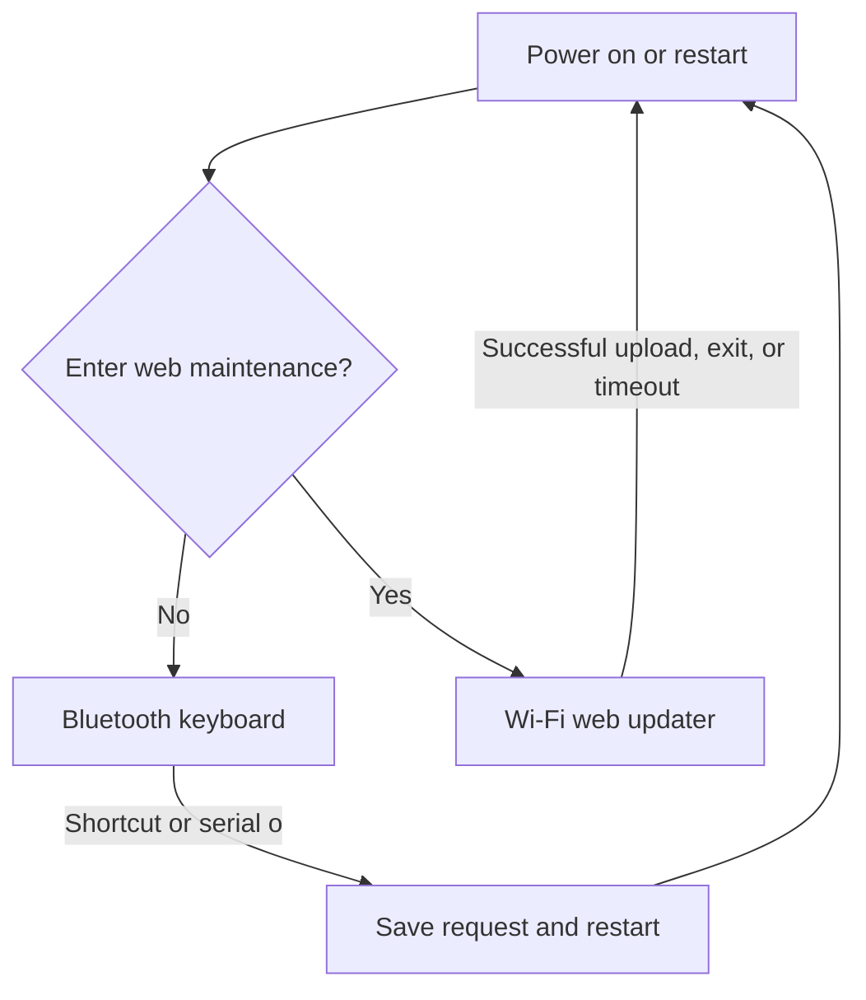

# HP KB-9970: PS/2 to Bluetooth LE, with web OTA

**A solid old keyboard, a modern wireless connection, and firmware that can now be updated without opening the case.**

*The assembled keyboard in daylight: the original full-size layout and enclosure, with a personal finish that makes the conversion my own.*

> **Current public firmware: V2.0.0 — November 2026.** The HP KB-9970 works as a Bluetooth LE keyboard while retaining its original controller, membrane matrix and lock LEDs. A complete update to V2.0.0 through the Wi-Fi web interface has now succeeded on my laboratory keyboard. Battery operation and power management remain an evolving part of the build.

This project converts an **HP KB-9970 / Chicony PS/2 keyboard** into a battery-powered **Bluetooth LE HID keyboard** using an **ESP32-C3 SuperMini**. The original keyboard controller still scans the keys. The ESP32 receives PS/2 scan codes, translates them into HID reports, and sends lock-LED commands back to the original controller.

V1 established the working conversion. V2 adds a practical way to maintain it: **enter update mode, connect to the keyboard's Wi-Fi, open a page, and drop in the new firmware**. I can develop on an accessible laboratory keyboard before installing a proven build in the enclosed keyboard.

## Contents

- [Why this keyboard is worth keeping](#why-this-keyboard-is-worth-keeping)
- [Personalization: daylight and after dark](#personalization-daylight-and-after-dark)
- [From V1 to V2](#from-v1-to-v2)
- [What measuring power consumption taught me](#what-measuring-power-consumption-taught-me)
- [Why I am keeping the recycled power-bank board](#why-i-am-keeping-the-recycled-power-bank-board)
- [Batteries: the advantage of having room](#batteries-the-advantage-of-having-room)
- [Hardware and wiring](#hardware-and-wiring)
- [How the firmware works](#how-the-firmware-works)
- [Build and first installation](#build-and-first-installation)
- [Updating over Wi-Fi](#updating-over-wi-fi)
- [Testing and platform behavior](#testing-and-platform-behavior)
- [Serial diagnostics](#serial-diagnostics)
- [Limits and remaining work](#limits-and-remaining-work)
- [Development and credits](#development-and-credits)

## Why this keyboard is worth keeping

I like this keyboard because it is solid, full-size, and still useful. Its original membrane, controller, key layout and status LEDs are worth preserving. An old connector is a reason to adapt the interface, not a reason to discard everything behind it.

The large enclosure also has a practical advantage: **there is useful space inside for the conversion electronics and a suitable battery installation**. I do not have to squeeze the whole project into an enclosure designed around two tiny disposable cells. That gives this build room to evolve, provided the battery and wiring are properly secured and the power circuit matches the chosen cell.

Making it wireless removes the cable from everyday use. Adding web updates removes the need to open it for every firmware change. That combination is my idea of a **super keyboard**: a familiar, substantial keyboard that I can repair, adapt and keep improving.

Earlier project photographs

These photographs remain part of the project's visual history alongside the additional exterior and assembly views below.

 

## Personalization: daylight and after dark

The daylight photograph at the top shows the original beige enclosure and full-size layout: function row, navigation block and numeric keypad. I added large key labels, warning-strip decoration and stickers inspired by Git, Linux, C++ and open hardware. The coding-themed sticker beside the navigation keys fits the project rather well. The original keyboard is still recognizable, with a finish that reflects what I enjoy building and using.

### The whole keyboard glowing

*A wider view in the dark, showing the green labels across the typing area, function row, navigation keys and numeric keypad, together with the glowing trim.*

The glow comes from **glow-in-the-dark adhesive stickers**, which I bought on Temu. They do not need an electrical connection or draw power from the keyboard battery. This is a way to customize the keycaps and make the legends stand out in the dark without adding a powered backlight to the conversion. The original **Caps Lock, Num Lock and Scroll Lock LEDs** are a separate part of the electronics and still follow the host's reported lock states.

### A closer look at the labels

*The close-up shows the dark lettering against the green glow, with matching labels on the larger keys and a long strip on the space bar.*

These photographs record the appearance of the stickers in the photographed conditions. They are not a measurement of brightness or how long the glow lasts. The useful distinction for this project is that the visual customization does not add another electrical load to the battery system.

## From V1 to V2

| Area | V1 | V2.0.0 |
| --- | --- | --- |
| Core function | Working PS/2-to-BLE conversion | Same original controller and key matrix retained |
| Firmware updates | USB programming | Initial USB installation, then browser-based Wi-Fi OTA |
| Lock LEDs | Bidirectional PS/2 synchronization | Better state tracking, acknowledgments, retries and recovery after transient failures |
| HID processing | 8 ms default software event gap | 4 ms default software event gap, with diagnostic alternatives |
| Power-bank keep-alive | Periodic extra CPU activity | Extra activity limited to a 20-minute keyboard-activity window, with an exception during OTA |
| Maintenance | Serial commands | Serial diagnostics plus a web page with drag and drop, progress and status |
| Physical recovery | Power disconnection when needed | A power switch is installed in my build |

**V1 and V2 are the public release sequence.** Names such as V6.1, V7.1 and V7.2 were laboratory iterations while developing the updater. The successful web-enabled build was consolidated as **2.0.0** so the public history remains understandable.

There is one deliberately retained legacy name: Bluetooth still advertises as **`HP KB9970 V3`**. That is the device's existing advertised name, kept for continuity with the working setup; it is not the public firmware version. The web page, `/status`, and startup output identify the firmware as **`2.0.0`**.

For future releases, the intended convention is `2.0.1` for fixes, `2.1.0` for compatible additions, and a new major version for incompatible changes.

## What measuring power consumption taught me

Someone on social media asked whether the original keyboard controller would consume too much power for a battery-powered conversion. It was a reasonable question: this is an older keyboard designed for a wired connection, rather than a modern battery-powered product.

After looking at the actual consumption, the important result in **my build** was that **the ESP32 side of the conversion was the main contributor, rather than the original keyboard controller**. That changed where it made sense to spend development effort. Keeping a useful old controller was not, by itself, the explanation for the battery drain.

Here, “the ESP32 side” means the conversion board and its operation as used in this assembly. It should not be read as a measurement of the bare ESP32 chip isolated from its regulator, board components and firmware behavior. Nor does this result establish the same power split for every PS/2 keyboard or ESP32 board.

The firmware work therefore focuses on avoiding unnecessary activity, recovering cleanly from errors, and preserving a good typing response. There is a real compromise: **160 MHz operation and measures intended to keep BLE responsive are performance choices, while generating extra CPU load for a power bank deliberately costs energy**. A shorter HID queue interval is not, by itself, an energy-efficiency result.

The consumption conclusion above is an observation from this build. A reproducible table of current readings, measurement points and operating conditions is still to be added to this documentation. Battery runtime has not yet been established here by a controlled discharge test.

## Why I am keeping the recycled power-bank board

This keyboard uses a **recycled IP5306-based power-bank board**. I have decided to keep that board in this particular assembly. Reusing it is part of the project, and the firmware needs to accommodate the hardware that is actually installed.

Its inconvenient feature is low-load shutdown: the board can turn off its output when the keyboard draws too little current. The IP5306 documentation describes this type of load-detection behavior, but the exact behavior of a recycled board should be checked on the actual hardware.[^ip5306]

The workaround is a **CPU-load keep-alive**. For short periods the ESP32 does additional work, increasing its load to discourage the power bank from switching off. In this firmware, the normal pattern is approximately **4 seconds of load activity followed by 18 seconds of rest**. Work is divided into short slices in a task below the keyboard loop's priority.

### The 20-minute inactivity policy

The goal is to keep the keyboard available while I am using it, including pauses to think, without keeping the power bank awake indefinitely after I walk away.

| Situation | Firmware behavior |
| --- | --- |
| Typing, or pausing for less than 20 minutes | The normal keep-alive policy remains eligible to run |
| 20 minutes since the last accepted keyboard activity | Stop generating the extra CPU load; stop the optional BLE warm reports as well |
| A new key event arrives while the electronics still have power | Renew the activity window |
| The power bank has already disconnected power | Use the physical power switch to restore operation |
| Web maintenance or firmware upload | Keep the maintenance power policy active through the update and restart |

The timer follows actual accepted PS/2 key activity. LED synchronization, BLE background work and the keep-alive itself do not count as someone using the keyboard.

**This is not a command to switch the battery off exactly at 20 minutes, and it is not ESP32 deep sleep.** After the extra load stops, the power bank decides whether and when to shut down. If it has already removed power, an unpowered ESP32 cannot detect a key press and wake itself. My chosen recovery is simply to switch the keyboard off and on.

### A new build does not have to inherit this workaround

Someone building the same conversion with a suitable supply that remains on at the keyboard's low load **would not need this power-bank keep-alive**. It is a consequence of my recycled power hardware, not a requirement of PS/2 or Bluetooth.

The supplied firmware retains the workaround for my board. The serial `k` command can disable normal CPU keep-alive for the current session, but it is not a permanent power-profile setting, and OTA maintenance has a separate override. A version intended for an always-on supply should deliberately configure that policy for its own hardware.

## Batteries: the advantage of having room

The enclosure has room that makes an internal battery practical and leaves options for a suitable higher-capacity installation. That is one of the benefits of starting with a large, solid keyboard: the battery does not have to dictate the keyboard's shape.

More usable battery energy can increase runtime at the same average load, but enclosure space alone does not establish capacity, efficiency or endurance. The selected cell, charging current, protection, converter losses and actual usage all matter. This project does not yet provide a verified “runs for X days” specification.

### Inside the enclosure

*The internal assembly uses space along the upper part of the original enclosure. Three blue cylindrical cells are visible, together with the recycled power-board assembly, USB connections, wiring, the ESP32-C3 board and the switch at the upper edge.*

This view explains why the enclosure is useful for a conversion: the components can be distributed inside the existing case while retaining the keyboard's external shape. It also shows why wireless firmware updates matter. The ESP32 is part of the internal installation, so having the updater available over Wi-Fi avoids opening the case for each software change.

The photograph records the physical arrangement; it does not by itself establish the cells' series/parallel connection, combined usable capacity or battery runtime. Some of the apparently open space is needed by the keyboard assembly when the case is closed, so battery clearance has to be checked with both halves fitted.

### Cell label and earlier assembly records

| Item | Recorded information |
| --- | --- |
| Cell in the earlier prototype | Blue 14500 Li-ion cell |
| Label | **3.7 V, 500 mAh, 1.85 Wh** |
| Usable capacity | Not independently established in this documentation |
| Power board | Recycled IP5306-based PCB, previously recorded as `D9-V1.0` |
| BLE battery percentage | Fixed placeholder value of **100%**, not a real measurement |

These are individual-cell label values, not a measured total for the three cells visible in the additional internal photograph. In particular, a capacity label does not prove that the recycled board's charging current is appropriate for the installed cells. Cell protection, charger current, insulation and mechanical mounting must be checked for the actual battery assembly.

The power path is **battery assembly → power-bank board → 5 V USB input on the ESP32 board**. The battery supply must match the voltage required by the power-bank circuit. In this particular keyboard, the original HP controller is powered from the ESP32 board's 3.3 V rail; the battery is not connected directly to that rail.

Battery, power board and internal assembly photographs

The following photographs document the earlier assembly stages. They are useful for seeing the available space and the recycled components; they are not a charging specification.

**IP5306 module, front and rear:**

**Cell label from the earlier prototype:**

## Hardware and wiring

| Part | Role |
| --- | --- |
| HP KB-9970 PS/2 keyboard | Original enclosure, key matrix, controller and status LEDs |
| ESP32-C3 SuperMini | PS/2 host, BLE HID device and Wi-Fi web updater |
| CLOCK, DATA and common ground | Bidirectional PS/2 connection |
| Recycled IP5306 power board | Battery charging/boost circuitry used in this assembly |
| Li-ion battery assembly | Internal energy storage; configuration and charging must match the installed cells and power board |
| Physical power switch | Manual power cycling |

### Signal connections

| Keyboard signal | ESP32-C3 connection |
| --- | --- |
| DATA | **GPIO4** |
| CLOCK | **GPIO3** |
| GND | **Common GND** |
| Keyboard supply | **3.3 V in this experimental build** |

**Electrical compatibility matters.** This HP keyboard is nominally a 5 V PS/2 device, and operating its controller at 3.3 V is a choice tested in this particular build. ESP32-C3 GPIOs must not be treated as 5 V-tolerant inputs. A keyboard powered at 5 V needs appropriate bidirectional level handling and verified pull-ups before connecting CLOCK and DATA. Check the actual pinout rather than relying on wire colors.[^esp32]

### The original matrix stays intact

The HP controller performs the matrix scanning it was designed to do. The ESP32 works at the PS/2 interface, so this conversion does not require tracing and reimplementing the complete membrane matrix.

The firmware targets PS/2 Scan Code Set 2. Other PS/2 keyboards may be adaptable, but their supply levels, scan codes, special keys and LED behavior need individual checks. A USB keyboard requires a USB host implementation; this CLOCK/DATA interface does not provide one.

## How the firmware works

### Two operating modes

Normal operation uses **Bluetooth with Wi-Fi off**. Maintenance uses **Wi-Fi without starting Bluetooth**. Entering maintenance saves a request and restarts the ESP32 into that mode; it does not try to keep typing over BLE during an upload.

The first installation of the web-enabled firmware can open maintenance automatically once. Later entries normally come from the shortcut or serial command. The internal NVS marker named `web72` is retained for compatibility with the laboratory firmware; it is not the current version number.

### PS/2 reception and HID reports

Clock interrupts capture DATA samples and timestamps into a bounded queue. The main loop validates frames, decodes Scan Code Set 2, and converts make/break sequences into keyboard or supported consumer-media HID events.

The receiver handles extended keys and special sequences. Queue limits, frame-error counters, pressed-key tracking and release/recovery paths are intended to stop a bad frame or stale event from silently leaving a key held.

V2 requests a **160 MHz CPU clock**, within the ESP32-C3's specified operating range.[^esp32] The default software gap between queued HID operations is **4 ms**. The BLE library is asked for a fast connection interval; the host ultimately negotiates the actual radio timing.[^hijel]

**A 4 ms software gap is not a measured 4 ms end-to-end key latency.** These settings and the queue changes target responsiveness; an instrumented latency benchmark remains separate work.

### Two different kinds of extra activity

The CPU keep-alive for the power bank is separate from the optional **BLE warm reports**. While the keyboard is still inside its activity window, the latter can send an empty HID report about every 500 ms when no keys are held and there is no pending key traffic. This is intended to reduce wake-up delay after pauses without generating characters or renewing the user's inactivity timer.

Both mechanisms have a cost. They are specific firmware tradeoffs, not evidence of the lowest possible power consumption. Serial `k` controls the normal CPU workaround; `z` controls the empty BLE reports.

### Original lock LEDs, with recovery

The computer reports its lock states through BLE. The firmware tracks the desired LED state, the command being sent, and the state actually acknowledged by the PS/2 controller.

It sends PS/2 **`0xED`** and the LED mask with acknowledgment handling, supports **`0xFE`** resend responses, and uses **`0xEE` Echo** with delayed retries to recover after errors. A transient command failure no longer means abandoning automatic LED synchronization for the rest of that boot.

The LEDs follow the host's reported state. The firmware does not simply flip Caps Lock locally whenever that key is pressed, and it cannot invent a Num Lock or Scroll Lock state that the host never reports.

### Watchdog and diagnostics

Normal operation configures a **15-second task watchdog**; maintenance uses a longer **60-second watchdog**. Reset causes, queue activity, LED state, free memory and other diagnostics are available over USB serial. The keyboard starts without waiting for a Serial Monitor connection.

A watchdog reset of the ESP32 is not necessarily a reset of the original HP controller. The physical power switch remains useful when the entire assembly needs a fresh start.

## Build and first installation

### Development configuration

| Setting | Configuration used for web OTA development |
| --- | --- |
| IDE | Arduino IDE |
| Board | **ESP32C3 Dev Module** |
| Espressif Arduino-ESP32 core | **3.3.10** in the recorded build configuration |
| CPU | **160 MHz** |
| Flash | **4 MB** on the development board |
| Partition scheme | OTA-capable default scheme used by this build |
| USB CDC On Boot | **Enabled** for native USB diagnostics |
| Serial Monitor speed | **115200 baud** |
| BLE libraries | **HijelHID_BLEKeyboard** and **NimBLE-Arduino** |

Keep the board and library configuration that compiled the working build. Exact BLE-library patch versions should be recorded with future releases; they are not fully pinned by this README. Upstream library documentation describes available APIs, but this firmware's own settings determine the behavior of this build.[^hijel][^nimble]

The current source is **`HP_KB9970_V2_0_0.ino`**. Put it in the matching Arduino sketch folder **`HP_KB9970_V2_0_0`**. Keep `v1.ino` as the original public version in the project history.

For a board that does not yet run this web-enabled firmware:

1. Install the ESP32 board support and the required BLE libraries.
2. Select the correct ESP32-C3 board, flash size and **OTA-capable partition scheme**.
3. Open the V2 sketch, compile it, and upload by USB.
4. The first installation of the web firmware may open maintenance automatically. Use the web page's return button or wait for the maintenance window to expire to return to Bluetooth.
5. Pair with **`HP KB9970 V3`** and check keys, LEDs and the update shortcut.

For the enclosed keyboard, the intended procedure is to install the complete version already tested on the laboratory keyboard. There is no need to first install a separate older “OTA program”: **the keyboard application and the web updater are included in the same firmware**.

### Preserve the OTA layout

The recorded partition table has two application slots, **1,310,720 bytes each**, plus OTA metadata. A new application must fit in its destination slot. The compiled `.bin` size, not the `.ino` source-file size, is what matters.

Application OTA writes the other application slot and selects it after validation. The page in this project updates the application only; it does not change the partition table or bootloader.[^ota] Keep the existing layout when compiling subsequent updates. Do not switch to a “No OTA” layout just to make a larger binary fit.

## Updating over Wi-Fi

### Connection details

| Item | Value |
| --- | --- |
| Enter maintenance | Hold **Ctrl + Alt + F12 for 3 seconds**, then **release all keys** |
| USB serial alternative | Send **`o`** |
| Wi-Fi network | **`HP-KB9970-WEB`** |
| Wi-Fi password | **`teclado1`** |
| Update page | **[http://192.168.4.1/](http://192.168.4.1/)** |
| Upload / return-button password | **`teclado`** |
| Status endpoint | **[http://192.168.4.1/status](http://192.168.4.1/status)** |

The network comes from the keyboard's own access point. An internet connection, home router and USB connection are not required for the browser upload.[^wifi] Compile and export the file before switching the computer to the keyboard's Wi-Fi.

### Upload procedure

1. Open the new sketch with the same board and partition settings, then use **Sketch → Export Compiled Binary** in Arduino IDE.
2. Choose the **application binary**. For this release it is **`HP_KB9970_V2_0_0.ino.bin`**.
3. Enter maintenance with the shortcut, then connect the computer or phone to **`HP-KB9970-WEB`**.
4. Open **http://192.168.4.1/**. Opening the page does not require a username or password.
5. Drag the application `.bin` into the page, or click the file area to select it. Enter **`teclado`** and press **Actualizar teclado**.
6. Keep power connected while the transfer and validation complete. After a successful update, the keyboard restarts into the new firmware.
7. Confirm that Bluetooth reconnects and normal typing works. Then enter maintenance again and check that the page or `/status` reports the new version.

**Do not upload the source `.ino`, a ZIP, `.merged.bin`, `.bootloader.bin`, `.partitions.bin`, or `boot_app0.bin`.** The updater expects a single ESP32-C3 application image.

The page checks file size against the available application slot. The receiver checks the expected image structure, target chip, transfer length and update result before committing it. These checks catch several common upload mistakes; they do not establish that a new application is bug-free or provide a signed-firmware system.

### What happens during maintenance

Bluetooth disconnects while the keyboard runs its Wi-Fi-only updater. This is expected. Use another input device if you need to type on the computer during maintenance.

The page has a **15-minute window to begin an update**. Visiting or refreshing it does not keep extending that deadline. Once a transfer starts, it has separate transfer limits. If no upload is started, the timeout returns the device to Bluetooth. The **Volver al teclado** button, using the same `teclado` password, also leaves maintenance.

The firmware retains the **8.5 dBm requested Wi-Fi transmit-power limit** that made the access point visible on my SuperMini during development. This is a working setting for this board, not a universal diagnosis for every ESP32-C3 Wi-Fi problem.

**Every future firmware image must retain the OTA implementation if wireless updating is to remain available.** Installing an otherwise valid application without the updater can remove the ability to update it this way.

### If the page does not open

Check that the computer is actually connected to **`HP-KB9970-WEB`**, that maintenance has not timed out, and that the address starts with **`http://`**. This network does not provide internet access.

On macOS versions with Local Network privacy controls, check the browser's permission under **System Settings → Privacy & Security → Local Network**. Trying the same address in another browser can help distinguish a browser issue from a connection issue.[^apple]

## Testing and platform behavior

### What has been demonstrated

| Observation | Scope |
| --- | --- |
| Ordinary keys, supported special keys and numeric keypad work over BLE | Observed on the converted HP keyboard |
| Original Caps / Num / Scroll LEDs respond on Windows | Observed during project testing |
| Typing and Caps Lock work on macOS | Observed during project testing |
| The web page opens and shows firmware status | Observed on the laboratory keyboard |
| Complete wireless update to **V2.0.0** | **Successfully performed on the laboratory keyboard** |
| ESP32 side identified as the main consumption contributor | Author's observations from this assembly; detailed measurement table still pending |

This confirms the update workflow on the laboratory build. The next checks are longer typing sessions, reconnection and LED recovery.

### Host-dependent lock keys

In the macOS tests, Num Lock and Scroll Lock did not behave like their Windows counterparts, and the corresponding LED-state changes were not reported in the same way. The firmware follows the states supplied by the host; it cannot make every operating system treat those keys identically.

Earlier diagnostic logs showed correct PS/2 make/break codes for Num Lock and Scroll Lock, and the corresponding HID usages were generated. Those historical logs helped separate keyboard decoding from host behavior; they are not a new V2 performance benchmark.

### Keyboard tester

[**Open the keyboard tester used during development on CodePen**](https://codepen.io/editor/PlusTer/pen/01a1b894-e483-7fb9-9cd7-3d6b39213d76)

After pairing, focus the test area and check normal keys, modifiers, navigation and the keypad. Browsers and operating systems intercept some shortcuts, so a missing browser event alone does not prove an electrical fault.

## Serial diagnostics

Use **115200 baud** and enable **USB CDC On Boot** when compiling for native USB diagnostics. Serial is optional during normal use and browser OTA.

| Command | Action |
| --- | --- |
| `s` | Print statistics |
| `h` | Show help |
| `d` | Toggle key-event debug output |
| `1` / `2` / `3` / `4` / `5` | Set the software HID gap to **20 / 12 / 8 / 4 / 2 ms** |
| `e` | Request PS/2 Echo |
| `l` | Request LED synchronization |
| `a` | Toggle automatic LED synchronization |
| `b` | Restart BLE when no PS/2 command/recovery or OTA transition is pending |
| `r` | Restart the ESP32 in normal mode |
| `k` | Toggle normal-mode CPU keep-alive |
| `p` | Request a CPU-load window while the activity period is still open; also re-enable normal keep-alive |
| `z` | Toggle empty BLE warm reports |
| `o` | Request web maintenance |
| `x` | Cancel an OTA-entry request or leave maintenance when appropriate |

Diagnostic settings are temporary. On restart, V2 returns to its defaults, including the **4 ms HID gap**. Maintenance only accepts the relevant commands; it does not permit an ordinary BLE restart command in the middle of an upload.

Leave key-event debug off during everyday use: those logs can contain information about what is being typed.

## Limits and remaining work

### Power and battery reporting

The current firmware does not measure battery capacity, current or state of charge. A BLE display of **100% is a placeholder**. Adding a suitable fuel gauge or validated measurement circuit remains future work.

The next useful power record is a set of repeatable measurements: original controller, ESP32 board, typing, idle, lock LEDs, keep-alive windows and OTA, with the voltage and measurement point specified. A full discharge test would then establish usable runtime for a named battery and usage pattern.

I am **keeping the recycled IP5306 board in this keyboard**. A different always-on supply remains an option for other builders, rather than a promised hardware replacement in my own build.

### Recovery and compatibility

The HP KB-9970 is the confirmed keyboard. Other models, supply arrangements and special-key implementations are not automatically covered. A prior freeze was observed during development without an established cause; neither undervoltage nor a particular software bug should be declared responsible without evidence.

The physical power switch can restart the whole assembly. It is not the same thing as a separately implemented ESP32 reset button, a PS/2 controller power switch, or a wake-on-key circuit after the power bank shuts down.

Keep the known-working source and compiled application binary. OTA validation rejects several incomplete or incompatible uploads, but a valid image can still contain a software error that prevents subsequent wireless recovery. USB remains the recovery path for that case.

### Wireless access

The firmware explicitly selects **Just Works** BLE pairing. That choice favors simple pairing and should not be described as a verified authenticated-pairing security design. No independent security audit is claimed.[^hijel]

The maintenance page uses **local HTTP** and the simple default passwords listed above. Anyone with those defaults and access to the maintenance network can authorize an upload. Change the credentials in a build intended for an environment where other people should not have that access. The image checks are not cryptographic firmware signatures.

### What I want to improve next

- Publish the current measurements with their conditions and a controlled runtime test.
- Add real battery reporting instead of the fixed percentage.
- Continue testing LED recovery, reconnection and long typing sessions on the laboratory keyboard.
- Record exact dependency versions alongside each release.
- Keep the enclosed keyboard on a version already exercised on the laboratory build.

## Development and credits

This is an iterative hardware-reuse project. I used AI assistance to develop and review firmware and to discuss circuit ideas, then tested changes on the actual hardware. The working result comes from that build-and-test process; AI-generated suggestions are not a substitute for measurements or hardware validation.

The BLE implementation uses [HijelHID_BLEKeyboard](https://github.com/HijelHub/HijelHID_BLEKeyboard) and [NimBLE-Arduino](https://github.com/h2zero/NimBLE-Arduino), on the [Espressif Arduino-ESP32 core](https://github.com/espressif/arduino-esp32).

**Project license:** pending selection. Dependency licenses remain those provided by their respective projects.

---

**Current public firmware:** V2.0.0  
**Original public firmware:** `v1.ino`  
**README updated:** 21 November 2026

## Technical references

The build observations above come from this project's hardware tests, firmware and development history. The references below describe the underlying components and APIs; they do not independently verify this keyboard's current draw or battery runtime.

[^esp32]: [Espressif — ESP32-C3 datasheet](https://www.espressif.com/sites/default/files/documentation/esp32-c3_datasheet_en.pdf). CPU capabilities and electrical operating limits.
[^ip5306]: [Injoinic — IP5306 datasheet, hosted by LCSC](https://www.lcsc.com/datasheet/C181692.pdf). Power-bank controller and low-load behavior; check the actual board implementation.
[^hijel]: [HijelHID_BLEKeyboard — upstream project](https://github.com/HijelHub/HijelHID_BLEKeyboard). HID interface, connection settings and pairing options. Upstream revisions may differ from the version installed for a particular build.
[^nimble]: [NimBLE-Arduino — upstream project](https://github.com/h2zero/NimBLE-Arduino).
[^ota]: [Espressif — ESP32-C3 OTA documentation](https://docs.espressif.com/projects/esp-idf/en/stable/esp32c3/api-reference/system/ota.html). Application slots and OTA metadata.
[^wifi]: [Espressif — Arduino-ESP32 Wi-Fi API](https://docs.espressif.com/projects/arduino-esp32/en/latest/api/wifi.html). Access-point mode.
[^apple]: [Apple — Control access to your local network on Mac](https://support.apple.com/en-gb/guide/mac-help/mchla4f49138/mac).
